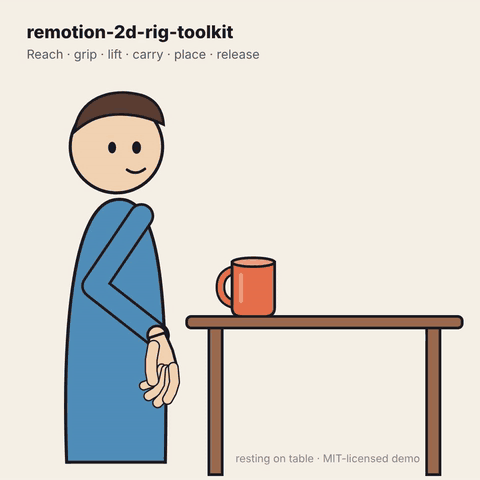
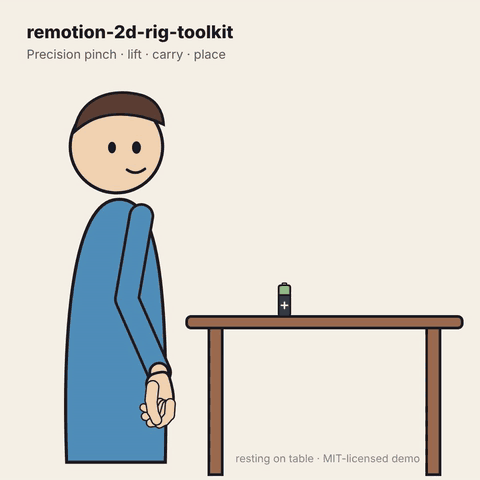

# remotion-2d-rig-toolkit

[](https://github.com/Trendtee/remotion-2d-rig-toolkit/actions/workflows/ci.yml)
[](LICENSE)


**Deterministic 2D arm IK, jointed cartoon hands and prop pickup/release helpers for Remotion and other frame-based renderers.**

When a character picks up a mug in a programmatic animation, the usual failure is not the arm. It is the half-second where the mug floats, snaps into the hand, slides through the fingers or drops onto the table by itself. This toolkit makes that contact explicit and **testable before you render**.

<p align="center">
  
  
</p>

<p align="center"><sub>Rendered with Remotion from <a href="examples/remotion-demo">examples/remotion-demo</a>. Both scenes pass the automated continuity check: 0.000 px contact error at pickup and release.</sub></p>

## Features

- **Two-bone arm IK.** Bone lengths never stretch. Out-of-reach targets clamp and are reported. You pick the elbow bend direction, and the solver returns the forearm and elbow angles.
- **Jointed hands.** Five digits with three segments each, joint limits, exact left/right mirroring and pose blending. Nine starter poses are included: `open`, `relaxed`, `fist`, `point`, `mugHandle`, `controller`, `batteryPinch`, `paperPinch` and `cableWrap`.
- **Exact grip points.** `wristForGrip()` tells you where the wrist must be so a closed hand lands exactly on an object's handle.
- **Prop ownership.** An object rests on a surface, is held by the hand, then is released onto a target surface. Positions are driven by anchors, not by eyeballed offsets.
- **Continuity QC.** `checkPickupContact()`, `checkReleaseContact()` and `inspectPropInteraction()` catch teleports, floating objects and slipping grips in a unit test.
- **Frame-based.** Every function is pure. There are no clocks, no randomness and no Remotion dependency in the core, and the same frame always gives the same pose.

## Install

The package is not on npm yet (see the [roadmap](#status-and-roadmap)). Install it from GitHub or from a local clone:

```bash
npm install github:Trendtee/remotion-2d-rig-toolkit
# or
git clone https://github.com/Trendtee/remotion-2d-rig-toolkit.git
cd remotion-2d-rig-toolkit && npm install && npm run build
npm install /path/to/remotion-2d-rig-toolkit   # inside your Remotion project
```

It requires Node.js 22 or newer. The library has **no runtime dependencies**.

## Quick start

```ts
import {
  point, solveTwoBoneArm, wristForGrip, attachHandToArm, digitPath, palmPath
} from 'remotion-2d-rig-toolkit';

const arm = {shoulder: point(320, 480), upperArmLength: 190, forearmLength: 180, elbowBend: 'clockwise'} as const;

// 1. Where should the hand's grip point be? (e.g. a mug handle)
const handle = point(560, 640);

// 2. Put the wrist where a closed mug grip lands exactly on the handle.
const wrist = wristForGrip(handle, {pose: 'mugHandle', forwardDegrees: 0, scale: 2});

// 3. Solve the arm and attach a jointed hand.
const solved = solveTwoBoneArm(arm, wrist);
const hand = attachHandToArm(solved, {pose: 'mugHandle', handAngle: 0, scale: 2});

// 4. Draw it however you like: SVG, canvas, Skia…
hand.digits.map(digitPath);  // "M… L… L… L…" per finger
palmPath(hand);              // closed palm outline
```

In Remotion, read `useCurrentFrame()` in your component and pass the frame to the toolkit's samplers. The [quick-start guide](docs/QUICKSTART.md) builds a complete pickup scene step by step.

## Pickup and release without teleports

```ts
import {point, checkPickupContact, checkReleaseContact, samplePropInteraction} from 'remotion-2d-rig-toolkit';

const interaction = {
  prop: {width: 150, height: 140, gripAnchor: point(18, 72), baseAnchor: point(92, 138)},
  initialBase: point(570, 712),          // where it stands before pickup
  finalBase: point(790, 712),            // where it is placed
  pickupFrame: 66,
  releaseFrame: 162,
  gripAtFrame: (frame: number) => handGripPoint(frame) // your animated hand
};

checkPickupContact(interaction);   // {ok, errorPx}: is the hand on the handle at pickup?
checkReleaseContact(interaction);  // would the mug float or snap after release?

const {phase, pose} = samplePropInteraction(interaction, frame);  // 'resting' | 'held' | 'released'
```

## Documentation

| | |
| --- | --- |
| [Quick start](docs/QUICKSTART.md) | Build a reach-grip-lift-place scene from scratch |
| [API reference](docs/API.md) | Every exported function and type |
| [Architecture](docs/ARCHITECTURE.md) | Coordinate system, design decisions, limitations |
| [Remotion demo](examples/remotion-demo/README.md) | Runnable Remotion project with two scenes and automated QC |
| [Changelog](CHANGELOG.md) | What changed in each version |
| [Contributing](CONTRIBUTING.md) | How to propose changes |

## What it is not

The toolkit is honest about its scope:

- **It is a 2D lateral-view hand model, not a 3D hand.** Fingers bend in the drawing plane and there is no out-of-plane rotation.
- **It has no collision detection.** You decide where the grip point is, and the toolkit makes the hand land on it. It does not check whether finger outlines overlap the object's outline.
- **It has no physics.** Released objects stay where they were released or are placed at `finalBase`, and nothing falls or bounces.
- **It has no character art.** You bring your own drawings. The demo art is deliberately simple placeholder art.

## Status and roadmap

**v0.2.0. Early, but tested:** 29 unit tests plus per-frame continuity QC on the demo scenes. The API may still change before 1.0. Planned next:

- an npm release with provenance,
- two-handed carries and hand-to-hand transfer,
- prop rotation during carry (tilting a mug, turning a page),
- more grip presets driven by real use cases. Please [open an issue](https://github.com/Trendtee/remotion-2d-rig-toolkit/issues/new/choose) with yours.

## Remotion licensing

This toolkit is MIT-licensed and does not depend on Remotion. If you render with **Remotion**, note that Remotion has its own license: it is free for individuals and organisations of up to three people, and larger companies need a company license. See [remotion.dev/license](https://www.remotion.dev/license).

## License

[MIT](LICENSE) © 2026 Trendtee. The demo artwork in this repository is original and MIT-licensed as well.
