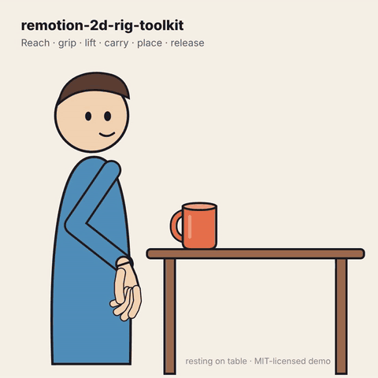
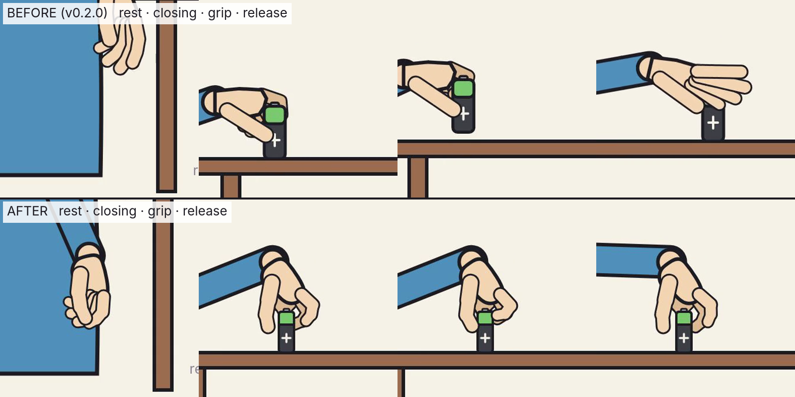

# Remotion demo: pickup, carry, place and release

Two compositions built with `remotion-2d-rig-toolkit` and original, neutral artwork:

| Composition | What it shows |
| --- | --- |
| `MugPickup` | Reach → open hand → contact on the mug handle → fingers close → lift → carry → place on the table → fingers open → return to a relaxed pose |
| `BatteryPinch` | Precision pinch: thumb on one side of a battery, index (supported by the middle finger) on the other, solved with `solvePinchGrip` |



## Run it

```bash
# 1. Build the toolkit (the demo depends on it via "file:../..")
cd ../..
npm install
npm run build

# 2. Install and open the demo
cd examples/remotion-demo
npm install
npm run studio          # opens Remotion Studio
```

Render to MP4:

```bash
npm run render:mug       # out/mug-pickup.mp4
npm run render:battery   # out/battery-pinch.mp4
```

Remotion downloads Chrome Headless Shell on first render. To use an existing Chrome instead, set
`REMOTION_BROWSER_EXECUTABLE=/path/to/chrome`.

To see the grip point, elbow and object phase on every frame, pass `--props='{"showGuides":true}'`.

## Automated continuity QC

```bash
npm run qc
```

`qc/continuity.test.mjs` runs the exact rig code used by the video (`src/rig.ts`) for every frame and fails if:

- the hand is not on the object's grip anchor at the pickup frame, or thumb/index are not touching between contact and release,
- a finger or the palm drawn in front of the object penetrates it,
- the object would float or snap to the table after release,
- the object slips relative to the hand while held,
- the object or wrist jumps more than a set number of pixels in one frame,
- an IK target is out of reach, the wrist bends past its limit, or the elbow locks straight.

Current result (verified locally with Node 22.23, Remotion 4.0.546):

| Scene | Pickup error | Release error | Max object step | Max wrist step | Elbow range |
| --- | --- | --- | --- | --- | --- |
| MugPickup | 0.000 px | 0.000 px | 8.9 px | 13.8 px | 32°–149° |
| BatteryPinch | 0.000 px | 0.000 px | 3.8 px | 15.8 px | 61°–162° |

BatteryPinch also checks contact every frame: thumb and index touch both sides (|clearance| < 0.6 px) from contact to release, never penetrate (minimum −0.00 px), the palm stays ≥ 12.9 px clear, the elbow changes by at most 5.5° per frame, the battery turns by at most 0.3° per frame while carried and does not move at all after release.



The QC test needs TypeScript type stripping in Node.js (22.18+ or 24+).

## How the scene is built

`src/rig.ts` keyframes three things per scene: the **grip point** (where the object's handle should be),
the **hand angle**, and the **finger closure**. For each frame it:

1. computes the wrist position that puts the *closed* grip pose on the grip point (`wristForGrip`),
2. solves the two-bone arm to that wrist (`solveTwoBoneArm`),
3. attaches a jointed hand and blends `relaxed → open → mugHandle` (`attachHandToArm`, `blendHandPoses`),
4. samples the object's ownership from the hand's actual grip point (`samplePropInteraction`).

Because the wrist is placed for the closed pose, the fingers close around the handle without the palm moving.

## Known limitations

- The hand is a planar, lateral-view cartoon hand. Fingers drawn behind the object (middle, ring, pinky in the pinch) may overlap it; that reads as depth, but it is not measured.
- In the mug scene the thumb rests across the front of the mug; it is not contact-checked like the pinch.
- The battery is drawn larger than a real AA cell relative to the hand (cartoon exaggeration) so the grip reads at 1080×1080.
- The character art is deliberately simple placeholder art for demonstrating the rig.

## Licensing

The demo code and artwork are MIT-licensed with the rest of this repository.
Remotion itself is **not** MIT-licensed: it is free for individuals and small companies, and larger
companies need a company license. Check [remotion.dev/license](https://www.remotion.dev/license) before commercial use.
